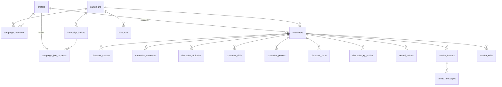

# 02 — Dati: cosa sta su git e cosa nel database

## Principio

| Dove | Cosa | Perché |
|---|---|---|
| **Repository git** (`src/game/`) | **Tabelle numeriche e formule**: modificatori e costi delle caratteristiche, costi dei livelli, tabella del mana e del costo di lancio, allenamento. Più la **configurazione legata al codice**: le 6 caratteristiche, le risorse (Spirito, Mana, Mente, Anima), i tipi di potere | Le formule e i loro test stanno insieme; si cambiano con una correzione al codice |
| **Database Supabase: cataloghi** | I **cataloghi del manuale**, con i loro testi: razze, classi e carriere, elementi, divinità, allineamenti, capacità, armi e armature | I testi si leggono in creazione personaggio e nel Compendio; le schede li richiamano con chiavi esterne vere |
| **Database Supabase: dati personali** | Utenti, campagne, personaggi, diari, domande al Master, tiri | Ognuno vede solo ciò che gli spetta (regole RLS) |

**I cataloghi si scrivono una volta**, con una migrazione che riporta il manuale (fonte: *Xerioth manuale*, testi identici, dubbi in 07). Non cambiano durante il gioco: nessuna pagina li modifica. Se un giorno serve correggerli, si scrive un'altra migrazione.

Le schede richiamano i cataloghi con una **chiave testuale** (`race_key = 'umano'`, `class_key = 'sacerdote'`, `skill_key = 'teologia'`), che ora è una **chiave esterna**: il database rifiuta chiavi inesistenti.

Convenzioni: tabelle e colonne in inglese (`snake_case`), testi visibili in italiano. Chiavi `uuid` per i dati personali, chiave testuale per i cataloghi; `created_at` / `updated_at` su ogni tabella di dati personali. Lo schema è scritto come **migrazioni SQL** in `supabase/migrations/`.

---

## 1. Cataloghi

### 1.1 Cosa resta su git (`src/game/`)

| File | Contenuto |
|---|---|
| `data/attributes.ts` | le 6 caratteristiche, tabella modificatore/booster, costi per arrivare al valore N (4–30) |
| `data/progression.ts` | costi dei livelli di capacità e incantesimi (0–20), costo dei livelli del personaggio |
| `data/classes.ts` | solo **risorse** (`RESOURCES`: etichetta, tetto, regole del mana) e **tipi di potere** (`POWER_KINDS`) |
| `data/training.ts` | capacità di supporto all'allenamento, punti per livello, maestri |
| `data/mana.ts` | tabella T per i Punti Mana, tabella costo di lancio |
| `rules/` | funzioni pure. Quelle che usavano un catalogo ricevono il dato come parametro (es. `maxHp` riceve il coefficiente della razza, `powerSections` le classi): i test usano piccoli cataloghi scritti nel test |

`races.ts`, `deities.ts`, `alignments.ts`, `skills.ts` e la lista `CLASSES` spariscono da git: il loro contenuto passa nella migrazione.

### 1.2 Tabelle dei cataloghi

Tutte con `key text primary key`, `name text`, `sort_order int`. I testi assenti nel manuale sono `''`.

**`races`**
| Colonna | Tipo | Esempio |
|---|---|---|
| `family_key` | → race_families | `umani`, `elfi`, `altre`, `ibride` (i gruppi della tab Razze) |
| `hp_coefficient` | int nullable | 7; null finché il Master non lo dà (Mezzelfo, Mezzorco, Icaro) |
| `appearance` | text | "Pelle dal quasi nero al rosa pallido…" |
| `size_lifespan` | text | "Taglia media. 150–180+ cm…" |
| `typical_alignment` | text | "Neutrale Puro" (testo libero: il manuale scrive anche "Tende al male") |
| `society` | text | "Insediamenti di ogni dimensione…" |
| `traits` | text | "Comune più una lingua a scelta…" |

L'introduzione comune agli elfi ("Tutti gli elfi sono leggeri, flessuosi…") sta in una tabella `race_families` (`key`, `name`, `intro`). Goblin e Satiro: famiglia `altre`, testi vuoti.

**`classes`**: classi e carriere.
| Colonna | Tipo | Esempio |
|---|---|---|
| `kind` | enum `class_kind` | `class` o `career` |
| `motto` | text | "Niente è come sembra" |
| `summary` | text | la frase sotto il titolo della tab |
| `sections` | jsonb | le righe con etichetta della tab, nell'ordine del manuale: `[{ "title": "Descrizione Generale", "text": "…" }, …]` |
| `resource_key` | text nullable | `mana`, `mente`, `anima`, `spirito` (chiave di `RESOURCES` in git) |
| `power_kind` | enum `power_kind` nullable | `spell`, `miracle`, `mental` |
| `power_label`, `power_singular` | text nullable | "Incantesimi", "Incantesimo" |
| `power_attribute` | enum `attribute` nullable | `intelligenza` |
| `requires_deity` | bool | true per il Sacerdote |
| `requires_element` | bool | true per l'Elementalista |

| Classe | Tipo | Risorsa | Poteri |
|---|---|---|---|
| Alteratore, Evocatore, Elementalista, Necromante, Magia Pura | classe | Mana | Incantesimi |
| Mentalista | classe | Punti Mente | Poteri mentali |
| Incantatore, Druido | classe | Anima | Incantesimi |
| Sacerdote | classe | Punti Spirito | Miracoli |
| Assassino, Ladro, Alchimista | carriera | — | — |

Il Guerriero non c'è (dubbio aperto in 07).

**`elements`**: le cinque vie dell'Elementalista.
| Colonna | Tipo | Esempio |
|---|---|---|
| `nature` | text | "Vento, fulmini, levitazione e invisibilità…" |
| `spell_examples` | text | "Evoca fulmine\nAumentare la gravità" |
| `creatures` | text | "Elementale dell'Aria…" |
| `opposite_key` | → elements nullable | `terra` (Puro: nessuno) |
| `deity_key` | → deities nullable | `ayla` (Puro: nessuna) |

**`deities`**
| Colonna | Tipo | Esempio |
|---|---|---|
| `motto` | text | "Il tempo non dimentica" |
| `domain` | text | "Dio del tempo e dello spazio" |
| `lore` | text | "La divinità": "Fratello di Zeria e Simrael…" |
| `divine_weapon` | text | "Clessidra di Tarooth, detta Tessitrice…" |
| `outsiders` | text | "Chimera, Leone Nero, Manticora, Sfinge." |
| `miracle_examples` | text | "Ferma tempo\nStasi corporale" |

13 divinità: le 9 con una tab nel manuale, più **Ayla, Rya, Droy, Enion** (divinità degli elementi), che si possono scegliere come Sacerdote ma nel manuale hanno solo il nome: testi vuoti tranne il dominio, che riporta l'elemento ("Aria", …). Le "Capacità collegate" sono identiche per tutti i Sacerdoti: stanno nelle `sections` della classe Sacerdote.

**`alignments`**: `code` ("LB"), `archetype` ("Il Crociato"), `description`, `example`.

**`skills`**: `attribute` (enum), `max_level` int, `description`, `requirements` jsonb (stessa struttura di oggi: `{ type: 'attribute' | 'skill' | 'power' | 'note', … }`). Contenuto: quello attuale di `skills.ts`, già allineato al manuale.

**`weapons`**: `category` text nullable ("Leggera", "Media", "Pesante", "Da tiro media", "Munizioni"), `skill_key` → skills nullable, `requirement` text, `note` text. Le voci "da definire" del manuale entrano con categoria vuota e la nota.

**`armors`**: `armor_type` text ("Leggera", "Media", "Pesante"), `description`, `requirement`, `note`.

**Permessi**: lettura per chiunque abbia fatto l'accesso; nessuna policy di scrittura (le scrive solo la migrazione).

**Nell'app**: `CatalogGate` (`src/features/catalog/`) scarica tutti i cataloghi con un'unica query all'avvio (pochi KB, cache senza scadenza) e mostra l'app solo dopo. I componenti li leggono con `useCatalog()`, le funzioni di etichetta con `getCatalog()`: `catalog.race(key)`, `catalog.klass(key)`, `catalog.deity(key)`, `catalog.element(key)`, `catalog.skill(key)`… I tipi stanno in `src/game/catalog.ts`.

**Controlli del database**: chiavi esterne verso i cataloghi; il trigger `check_character_class` rifiuta un Sacerdote senza divinità, un Elementalista senza elemento, e divinità o elemento su classi che non li prevedono. Migrazione: `20261118012220_catalogs.sql`.

### 1.3 Modifiche alle schede

- `character_classes.element_key` → elements, nullable: l'elemento dell'Elementalista. Obbligatorio se la classe ha `requires_element`, vuoto altrimenti (lo controlla il database).
- `character_classes.deity_key`: obbligatorio se la classe ha `requires_deity`, vuoto altrimenti.
- Chiavi esterne: `characters.race_key` → races, `characters.alignment_key` → alignments, `character_classes.class_key` → classes, `character_classes.deity_key` → deities, `character_skills.skill_key` → skills.
- Omnia usa `umano`, `legale_neutrale`, `sacerdote`, `tarooth` e le chiavi attuali delle capacità: restano uguali.

---

## 2. Database (Supabase)

### 2.1 Utenti, campagne e Master

**`profiles`**: una riga per utente, creata in automatico alla registrazione (trigger `handle_new_user`). `display_name` viene, nell'ordine, dal nome scritto alla registrazione con email, dal nome dell'account Google (`full_name` / `name`), dalla parte dell'email prima della `@`.
| Colonna | Tipo |
|---|---|
| `id` | uuid PK (= `auth.users.id`) |
| `display_name` | text |

**`campaigns`**: gruppi di gioco separati.
| Colonna | Tipo |
|---|---|
| `id` | uuid PK |
| `name` | text (es. "Xerioth") |
| `description` | text |

**`campaign_members`**: chi partecipa e con quale ruolo.
| Colonna | Tipo | Note |
|---|---|---|
| `campaign_id` | → campaigns | PK composta |
| `user_id` | → profiles | PK composta |
| `role` | enum `member_role` (`player`, `master`) | si assegna all'ingresso (dall'invito); **non si cambia dall'app** |

Il Master è tale **per campagna**: in una campagna diversa può essere un'altra persona. Ogni utente può far parte di **più campagne**, con un ruolo diverso in ciascuna, e avere **più personaggi** nella stessa campagna.

**Qualsiasi utente** può creare una campagna dall'app (funzione `create_campaign`): ne diventa il primo Master. Gli altri entrano con gli **inviti** (§2.1b). Il Master modifica nome e descrizione dal pannello (policy `campaigns_update_master`, già presente).

Nessuna policy permette di inserire o modificare righe di `campaign_members` dall'app: si entra solo creando la campagna o con una richiesta accettata (funzione `decide_join_request`). Il Master può **cancellare** le righe dei **giocatori** della sua campagna (policy `campaign_members_delete_master`, non sé stesso e non altri Master).

### 2.1b Inviti e richieste di ingresso

> ✅ **Applicata** il 17/11/2026 (`20261117211321_campaign_invites.sql`), con la creazione delle campagne e l'accesso ai personaggi legato all'appartenenza alla campagna. Per gli inviti l'app può scrivere solo le colonne `campaign_id`, `role`, `single_use` (creazione) e `revoked_at` (revoca); un vincolo fissa `expires_at` a `created_at` + 7 giorni.

1. Il Master crea un **invito** dal pannello e ne copia il link `https://xerioth-character-sheet.pages.dev/invito/<id>`.
2. Chi apre il link accede (o si registra) e preme il pulsante: nasce una **richiesta in attesa**.
3. Il Master la **accetta** (l'utente entra con il ruolo dell'invito) o la **rifiuta**.

**`campaign_invites`**
| Colonna | Tipo | Note |
|---|---|---|
| `id` | uuid PK | è anche il token del link (casuale, non indovinabile) |
| `campaign_id` | → campaigns | |
| `role` | `member_role` | `player` o `master`: ruolo di chi entra con questo invito |
| `single_use` | bool | `true` = monouso, `false` = riutilizzabile |
| `expires_at` | timestamptz | `created_at` + **7 giorni** (default, l'app non lo invia) |
| `revoked_at` | timestamptz nullable | revocato dal Master |
| `created_by` | → profiles | |
| `created_at` | timestamptz | |

Un invito è **valido** se non è revocato, non è scaduto e, se monouso, non ha ancora nessuna richiesta. Il monouso si consuma alla **richiesta** (anche se poi viene rifiutata), così il link non può girare ad altri. Gli utilizzi di un invito sono il numero delle sue richieste.

**`campaign_join_requests`**
| Colonna | Tipo | Note |
|---|---|---|
| `id` | uuid PK | |
| `invite_id` | → campaign_invites | |
| `campaign_id` | → campaigns | copiato dall'invito |
| `user_id` | → profiles | chi chiede di entrare |
| `role` | `member_role` | copiato dall'invito |
| `status` | enum `join_request_status` (`pending`, `accepted`, `rejected`) | |
| `decided_by` | → profiles nullable | Master che ha deciso |
| `decided_at` | timestamptz nullable | |
| `created_at` | timestamptz | |

Al massimo **una richiesta `pending`** per utente e campagna (indice unico parziale) e **una richiesta per utente e invito** (vincolo unico): dopo un rifiuto, con quell'invito non si può più chiedere, serve un invito nuovo. Le richieste si vedono **solo nel pannello Master**, senza avvisi in home.

**Funzioni** (`security definer`, eseguibili dagli utenti autenticati):

| Funzione | Chi | Cosa fa |
|---|---|---|
| `create_campaign(name, description)` | qualsiasi utente | crea la campagna e inserisce chi la crea in `campaign_members` come `master`; restituisce l'id |
| `invite_info(invite_id)` | chiunque abbia il link | nome della campagna, ruolo, stato dell'invito (`valid`, `expired`, `revoked`, `used`), se l'utente è già membro e lo stato della sua richiesta con quell'invito (nessuna, `pending`, `rejected`). Serve perché chi non è membro non può leggere la campagna |
| `request_to_join(invite_id)` | chiunque abbia il link | controlla l'invito e crea la richiesta `pending`; errore se l'invito non è valido, se l'utente è già membro o ha già una richiesta con quell'invito |
| `decide_join_request(request_id, accept)` | Master della campagna | segna la richiesta `accepted`/`rejected`; se accettata inserisce la riga in `campaign_members` con il ruolo della richiesta |

**Rimozione di un giocatore**: si cancella la sua riga di `campaign_members`. **I personaggi restano**: il Master continua a vederli, il giocatore no finché non rientra (vedi §3).

### 2.2 Personaggio

**`characters`**
| Colonna | Tipo | Esempio Omnia |
|---|---|---|
| `id` | uuid PK | |
| `campaign_id` | → campaigns | Xerioth |
| `owner_id` | → profiles | giocatore |
| `name` | text | Omnia Tenem |
| `race_key` | text → races | `umano` |
| `age` | int | 26 |
| `alignment_key` | text → alignments | `legale_neutrale` |
| `height_cm`, `weight_kg` | int | 175, 75 |
| `eyes`, `skin`, `hair` | text | Ambra, Abbronzata, Bianchi |
| `level` | int | 23 |
| `xp_total` | int | **non usata**: valore storico dell'import. Il totale si calcola da `character_xp_entries` |
| `hp_bonus` | int | 100 (Bracciale Vita) |
| `temp_hp` | int | 0 |
| `damage_taken` | int | 44 |
| `madness_points` | int | 16 |
| `fate_points` | int | 5 |
| `gold` | bigint | 262609 |
| `portrait_url` | text | |
| `background` | text | storia |

**Calcolati, non salvati**: modificatori, PF massimi e attuali, esperienza del livello, costi, totali dei tiri.

**`character_classes`**: le classi del personaggio.
| Colonna | Tipo | Esempio |
|---|---|---|
| `character_id` | → characters | |
| `class_key` | text → classes | `sacerdote` |
| `deity_key` | text nullable → deities | `tarooth` (solo se la classe lo richiede) |
| `element_key` | text nullable → elements | `fuoco` (solo Elementalista) |
| `patron` | text nullable | "Vortex" (figlio del Dio) |
| `sort_order` | int | |

**`character_resources`**: Spirito, Mana, Mente, Anima…
| Colonna | Tipo | Esempio |
|---|---|---|
| `character_id` | → characters | |
| `resource_key` | text | `spirito` |
| `current` | int | 125 |
| `max` | int nullable | 600 (se non è calcolato) |

**`character_attributes`** (le "caratteristiche"; in D&D inglese si chiamano *ability scores*, ma qui uso `attributes` per non confonderle con la caratteristica "Abilità")
| Colonna | Tipo | Note |
|---|---|---|
| `character_id` | → characters | PK composta |
| `attribute` | enum | `abilita`, `costituzione`, `intelligenza`, `riflessi`, `freddezza`, `fascino` |
| `value` | int | 23 |
| `advancement` | int | punti accumulati finora verso il valore successivo |

**`character_skills`** (Capacità)
| Colonna | Tipo | Note |
|---|---|---|
| `id` | uuid PK | |
| `character_id` | → characters | |
| `skill_key` | text nullable → skills | dal catalogo |
| `custom_name` | text nullable | per varianti o capacità fuori catalogo: "Cavalcare (Viverna)" |
| `attribute` | enum | caratteristica usata nei tiri |
| `level` | int nullable | `null` = non appresa (NA) |
| `advancement` | int | punti accumulati verso il livello successivo |
| `is_maxed` | bool | "siamo al MAX": blocca il livello |
| `description` | text nullable | se diversa dal catalogo |
| `sort_order` | int | |

**`character_powers`** (Miracoli / Incantesimi / Poteri mentali)
| Colonna | Tipo | Esempio |
|---|---|---|
| `id` | uuid PK | |
| `character_id` | → characters | |
| `kind` | enum (`miracle`, `spell`, `mental`) | miracle |
| `name` | text | Ruba tempo |
| `level` | int nullable | 4 |
| `is_maxed` | bool | |
| `acquisition_level` | int nullable | 10 (serve per il costo in mana) |
| `range`, `area`, `cast_time`, `cost`, `duration` | text | "Personale", "8", "70", "30 minuti" |
| `advancement` | int | 119 |
| `is_special` | bool | potere speciale (etichetta) |
| `success_die` | int 0–20 nullable | dado riuscita scelto dal Master; a livello 0 solo 20. Lo cambia **solo il Master** (trigger `guard_power_success_die`); null = da fissare |
| `success_target` | int nullable | riuscita fissa: dado + caratteristica + modificatore + livello al momento della scelta del dado. Il tiro riesce se totale ≥ valore. Solo il Master (stesso trigger) |
| `granted_by` | text nullable | "Vortex", "Eridani" |
| `description` | text | |
| `sort_order` | int | |

**`character_items`** (Inventario)
| Colonna | Tipo | Note |
|---|---|---|
| `id` | uuid PK | |
| `character_id` | → characters | |
| `category` | enum (`usable`, `equipment`) | Oggetti utilizzabili / Equipaggiamento |
| `slot` | enum nullable (`weapon`, `armor`) | per armi e armature |
| `equipped` | bool | in uso (il TRUE/FALSE di oggi) |
| `name` | text | |
| `description` | text | |
| `quantity` | int | |
| `charges_remaining`, `charges_total` | int nullable | |
| `value` | text nullable | "50.000 mo", "Reliquia di Tarooth ($$$$)" |
| `sort_order` | int | |

**`character_xp_entries`** (Registro dell'esperienza, solo aggiunta)
| Colonna | Tipo | Note |
|---|---|---|
| `id` | uuid PK | |
| `character_id` | → characters | |
| `amount` | int ≠ 0 | +/− punti esperienza |
| `note` | text | "Esperienza dal foglio" per la voce iniziale |
| `created_by` | → profiles nullable | chi l'ha aggiunta (giocatore o Master) |
| `created_at` | timestamptz | |

✅ L'esperienza totale è **sempre la somma delle voci**, mai un valore salvato. Le voci non si modificano né si cancellano: un errore si corregge con una voce di segno opposto. Leggono e aggiungono il proprietario e il Master.

✅ Armi e armature sono **Equipaggiamento con tipo arma/armatura**; la Panoramica mostra quelle "in uso".

**`journal_entries`** (Diario)
| Colonna | Tipo | Note |
|---|---|---|
| `id` | uuid PK | |
| `character_id` | → characters | |
| `kind` | enum | `prayer`, `note`, `todo`, `purchase`, `communication`, `conversation`, `story`, `lore`, `npc` |
| `chapter` | text nullable | "105 Giorni", "Castello Malek" |
| `title` | text nullable | |
| `body` | text | markdown |
| `addressed_to` | text nullable | preghiere: "Tarooth", "El Olamin" |
| `tags` | text[] | |
| `visibility` | enum | `private` (solo autore), `master` (autore + Master, default) |
| `done` | bool | per "cose da fare" e "acquisti" |
| `sort_order` | int | |

### 2.3 Domande al Master

Sostituiscono "avanzamenti da approvare" e "risposte del Master". **I livelli si alzano senza conferma**, ma su **qualsiasi elemento** della scheda (capacità, miracolo, oggetto, caratteristica, voce di diario/preghiera…) il giocatore può aprire una **domanda**:

1. il giocatore scrive la domanda su un elemento;
2. il Master riceve una **notifica**, apre la domanda e viene portato direttamente all'elemento;
3. il Master risponde; il giocatore **chiude** il dubbio oppure risponde di nuovo.

**`master_threads`**
| Colonna | Tipo | Note |
|---|---|---|
| `id` | uuid PK | |
| `character_id` | → characters | |
| `target_type` | enum | `character`, `attribute`, `skill`, `power`, `item`, `journal` |
| `target_id` | text nullable | id dell'elemento (o chiave della caratteristica) |
| `title` | text | es. "Corde di Tarooth: cosa fanno al livello 8?" |
| `status` | enum | `open` (attende il Master), `answered` (attende il giocatore), `closed` |
| `last_message_at` | timestamptz | per ordinare e notificare |

**`thread_messages`**: `thread_id`, `author_id`, `body`, `created_at`.

Le **preghiere** usano lo stesso meccanismo: una preghiera è una voce di diario con una domanda aperta verso il Master.

Notifiche: badge con il numero di domande in attesa e aggiornamento in tempo reale (Supabase Realtime). Le notifiche email si possono aggiungere più avanti.

### 2.3b Modifiche del Master

> ✅ **Applicata** il 17/11/2026 (`20261117211855_master_edits.sql`).

Il Master può cambiare **qualsiasi** dato della scheda di un giocatore. Ogni modifica:
1. viene **segnalata al giocatore** con un asterisco bordeaux accanto al valore cambiato;
2. può avere una **motivazione** (facoltativa), che il Master scrive al momento del salvataggio;
3. resta per sempre nello **storico** ("Modifiche del Master", linguetta Domande), anche dopo che il giocatore ha **tolto** il segno.

Conta come modifica del Master ogni scrittura fatta da un Master della campagna su un personaggio **di cui non è il proprietario**. Le modifiche del Master ai propri personaggi non si registrano.

**`master_edits`**
| Colonna | Tipo | Note |
|---|---|---|
| `id` | uuid PK | |
| `character_id` | → characters | |
| `target_type` | enum `edit_target` | `character`, `class`, `attribute`, `resource`, `skill`, `power`, `item`, `xp` |
| `target_id` | text nullable | id dell'elemento (o chiave della caratteristica / risorsa); null per i dati del personaggio |
| `target_label` | text | nome dell'elemento al momento della modifica ("Corrosione", "Bracciale Vita"), così si legge anche dopo un'eliminazione |
| `action` | enum `edit_action` | `insert` (aggiunto), `update` (cambiato), `delete` (eliminato) |
| `field` | text nullable | colonna cambiata (`level`, `damage_taken`, `description`…); null per aggiunte ed eliminazioni |
| `old_value`, `new_value` | jsonb nullable | valore prima e dopo |
| `reason` | text nullable | motivazione del Master |
| `edited_by` | → profiles | Master che ha modificato |
| `created_at` | timestamptz | uguale per tutte le righe dello stesso salvataggio |
| `updated_at` | timestamptz | ultima modifica della riga (vedi "Modifiche ripetute") |
| `dismissed_at` | timestamptz nullable | il giocatore ha tolto il segno; serve solo al giocatore, il Master non lo vede |

- **Le scrive il database**, non l'app: un trigger `after insert/update/delete` su `characters`, `character_classes`, `character_attributes`, `character_resources`, `character_skills`, `character_powers`, `character_items` e `character_xp_entries` registra una riga per ogni colonna cambiata (esclusi `updated_at` e `sort_order`). Così nessuna modifica sfugge, da qualunque punto della scheda arrivi.
- **Modifiche ripetute**: se lo stesso valore (stessi `target_type`, `target_id`, `field`) viene cambiato di nuovo mentre il segno è ancora presente (`dismissed_at` null), il trigger **aggiorna la riga esistente** invece di crearne una nuova: `old_value` resta il valore di partenza, `new_value` diventa l'ultimo, `reason` e `edited_by` diventano quelli dell'ultima modifica, `updated_at` si aggiorna. Dopo che il giocatore ha tolto il segno, una nuova modifica crea una riga nuova.
- **Motivazione**: l'app la invia insieme alla scrittura in un'intestazione della richiesta (`x-edit-reason`, codificata in base64 per gli accenti); il trigger la legge da `request.headers` e la salva nelle righe.
- **Togliere il segno**: funzione `dismiss_master_edits(ids)`, solo per il proprietario; imposta `dismissed_at`. Le righe non si cancellano mai.
- In tempo reale (Realtime), così il segno compare al giocatore mentre ha la scheda aperta.

### 2.4 Tiri di dado

> ✅ Si tira **solo sui propri personaggi** (`20261117211147_roll_own_characters_only.sql`): la policy `dice_rolls_insert` usa `is_character_owner` al posto di `can_access_character`, quindi il Master non può tirare sulle schede dei giocatori; i tiri esistenti restano visibili come prima.

> ✅ **Applicata** il 15/11/2026 (`supabase/migrations/20261115190311_dice_roll_feed.sql`), riscritta senza DROP/DELETE: i tiri nascosti restano nel feed con `hidden = true` e la regola di lettura li esclude.

Il gruppo vede di ogni tiro **solo il totale e l'esito** (successo / fallimento / critico negativo). Per questo ci sono due tabelle:

- **`dice_rolls`**: il tiro completo (nome della prova, dadi, scomposizione). Lo vedono **solo chi tira e il Master**.
- **`dice_roll_feed`**: la versione pubblica (personaggio, totale, esito, data), compilata in automatico da un trigger. La vede **tutto il gruppo**, in tempo reale. I tiri "nascosti" non ci finiscono.

L'esito c'è solo per i poteri e si calcola da solo (totale contro `success_target`, poi ritiro). Caratteristiche e capacità non hanno esito: le classi difficoltà le conosce solo il Master.

**`dice_rolls`**
| Colonna | Tipo | Note |
|---|---|---|
| `id` | uuid PK | |
| `campaign_id` | → campaigns | |
| `character_id` | → characters | |
| `label` | text | "Corrosione" |
| `die` | enum (`d4`, `d6`, `d8`, `d10`, `d12`, `d20`, `d100`, `coin`) | i dadi oltre a d20/d4/coin servono al tiro libero (migrazione `20261116223918_more_dice`) |
| `results` | int[] | anche più tiri (critico negativo → ritiro) |
| `total` | int nullable | null se riuscita decisa dal Master |
| `details` | jsonb | scomposizione (caratteristica, mod, livello) |
| `outcome` | enum nullable (`success`, `failure`, `critical_failure`) | |
| `hidden` | bool | tiro nascosto: non va nel feed pubblico |

L'uso dei Punti Fato **non** si registra.

---

## 3. Sicurezza (Row Level Security)

| Chi | Può |
|---|---|
| **Giocatore** | leggere e modificare **solo i propri** personaggi (e tabelle figlie) **delle campagne di cui è membro**; vedere i tiri pubblici della propria campagna; vedere le proprie richieste di ingresso e il nome delle campagne a cui le ha inviate |
| **Qualsiasi utente** | creare una campagna (ne diventa Master) |
| **Master** (della campagna) | leggere e modificare **tutti** i personaggi della campagna (le modifiche ai personaggi altrui finiscono in `master_edits`, §2.3b), ma **non tirare** sui personaggi altrui; modificare nome e descrizione della campagna; rispondere alle domande; creare e revocare inviti; accettare o rifiutare le richieste (e vedere il nome di chi chiede); rimuovere i giocatori |
| **Nessuno** dall'app | cambiare ruoli; entrare in una campagna senza invito e richiesta accettata; rimuovere un Master |

- Il proprietario accede ai suoi personaggi **solo se è membro** della loro campagna: le regole su `characters` e le funzioni `can_access_character` / `is_character_owner` controllano anche `is_campaign_member`. Così un giocatore rimosso non vede più le schede di quella campagna, ma restano al loro posto.
- `campaign_invites`: lettura, creazione e revoca (`revoked_at`) solo per il Master della campagna.
- `campaign_join_requests`: lettura per chi ha chiesto e per il Master della campagna; nessuna scrittura diretta (solo dalle funzioni del §2.1b).
- `master_edits`: lettura per il proprietario del personaggio e per il Master della campagna; nessuna scrittura diretta (le righe le crea il trigger, il segno si toglie con `dismiss_master_edits`).
- `campaigns`: leggibile anche da chi ha una richiesta `pending` verso la campagna (per mostrarne il nome).
- `profiles`: leggibile anche dal Master di una campagna verso cui l'utente ha una richiesta `pending`.

- Le voci di diario `private` le vede solo l'autore, quindi neanche il Master.
- I giocatori **non** vedono le schede degli altri. Più avanti si può aggiungere una "vista party" con le sole info pubbliche (nome, razza, classi, livello, ritratto).

---

## 4. Fase 3 — Moduli informativi (bozza)

Un **template grezzo** in cui il Master compone pagine con **moduli** (blocchi):

- **testo** / **descrizione**;
- **tabella** (colonne libere);
- **immagine** (es. Mappa di Zeria);
- **data a calendario** (evento, compleanno, battaglia…).

Tabelle previste: `world_pages` (campagna, titolo, pagina padre, visibilità, ordine) e `page_blocks` (pagina, tipo, contenuto jsonb, ordine). Più `page_shares` per mostrare una pagina solo ad alcuni personaggi (es. "sblocco" di una voce del bestiario).

Così si aggiungono nuove categorie di informazioni **senza modificare il database**. Il dettaglio dei componenti lo discutiamo quando ci arriviamo.
