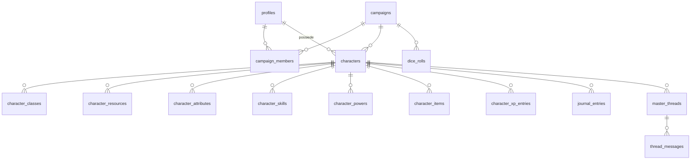

# 02 — Dati: cosa sta su git e cosa nel database

## Principio

| Dove | Cosa | Perché |
|---|---|---|
| **Repository git** (`src/game/data/`) | Dati che **non variano**: tabelle dei costi, modificatori, razze e coefficienti PF, classi (template), divinità, allineamenti, catalogo capacità e requisiti, tabelle mana e allenamento | Versionati e revisionabili; si cambiano con una correzione al codice |
| **Database Supabase** | Dati che **variano** e sono **personali**: utenti, campagne, personaggi, diari, domande al Master, tiri | Ognuno vede solo ciò che gli spetta (regole RLS) |

Nel database i dati statici si richiamano con una **chiave testuale**, ad esempio `race_key = 'umano'`, `class_key = 'sacerdote'`, `skill_key = 'teologia'`. Il controllo che la chiave esista lo fa l'app.

Convenzioni: tabelle e colonne in inglese (`snake_case`), testi visibili in italiano. Chiavi `uuid`, con `created_at` / `updated_at` su ogni tabella. Lo schema è scritto come **migrazioni SQL** in `supabase/migrations/`.

---

## 1. Dati statici su git (`src/game/data/`)

| File | Contenuto |
|---|---|
| `attributes.ts` | le 6 caratteristiche, tabella modificatore/booster, costi per arrivare al valore N (4–30) |
| `progression.ts` | costi dei livelli di capacità e incantesimi (0–20), costo dei livelli del personaggio |
| `races.ts` | razze, descrizione, coefficiente PF |
| `classes.ts` | **template di classe** (vedi sotto) |
| `deities.ts` | divinità (Xenea, Vex, Morgoroth, Tarooth, Ydelx, Xutux Nero, Xutux Bianco, Zeria…) |
| `alignments.ts` | 9 allineamenti con descrizione |
| `skills.ts` | catalogo capacità: caratteristica, livello max indicativo, descrizione, requisiti strutturati |
| `training.ts` | capacità di supporto all'allenamento, punti per livello, maestri |
| `mana.ts` | tabella T per i Punti Mana, tabella costo di lancio |

### Template di classe

Una classe descrive **cosa ha** un personaggio di quella classe, in modo che la scheda si adatti da sola:

```ts
{
  key: 'sacerdote',
  name: 'Sacerdote',
  requiresDeity: true,          // "Sacerdote di …": si sceglie la divinità
  powers: { kind: 'miracle', label: 'Miracoli', attribute: 'intelligenza' },
  resource: { key: 'spirito', label: 'Punti Spirito', cap: 600, computed: false },
}
{
  key: 'elementalista_fuoco',
  name: 'Elementalista del Fuoco',
  powers: { kind: 'spell', label: 'Incantesimi', attribute: 'intelligenza' },
  resource: { key: 'mana', label: 'Punti Mana', computed: true },   // formula §3 delle regole
}
```

- Un personaggio può avere **più classi** (es. Xander: Mentalista + Assassino). Le sezioni della scheda (Miracoli, Incantesimi, Poteri mentali) e le risorse (Spirito, Mana, Mente, Anima) compaiono in base alle classi.
- Il foglio *Razze e Classi* elenca le scuole di magia: Alterazione, Evocazione, Elementalista Aria/Acqua/Fuoco/Terra, Mentalista, Necromante, Magia Pura, Incantatore. Le userei come classi da mago.
- Possono servire **tabelle di conversione** per calcolare il costo dei poteri: si aggiungono al template della classe quando servono.

⏳ **Elenco delle classi**: lo fornirai più avanti, con il mapping classe → etichetta dei poteri. Ogni template ha `powers.label` / `powers.singular` (es. Sacerdote → "Miracoli" / "Miracolo"): la scheda Poteri prende il nome da lì. Intanto ci sono i template provvisori Sacerdote (Punti Spirito), Mago generico (Mana), Mentalista (Punti Mente) e Classe senza poteri.

---

## 2. Database (Supabase)



### 2.1 Utenti, campagne e Master

**`profiles`**: una riga per utente, creata in automatico alla registrazione.
| Colonna | Tipo |
|---|---|
| `id` | uuid PK (= `auth.users.id`) |
| `display_name` | text |

**`campaigns`**: gruppi di gioco separati.
| Colonna | Tipo |
|---|---|
| `id` | uuid PK |
| `name` | text (es. "Xerioth") |
| `description` | text |

**`campaign_members`**: chi partecipa e con quale ruolo.
| Colonna | Tipo | Note |
|---|---|---|
| `campaign_id` | → campaigns | PK composta |
| `user_id` | → profiles | PK composta |
| `role` | enum `member_role` (`player`, `master`) | **si cambia solo da database** |

Il Master è tale **per campagna**: in una campagna diversa può essere un'altra persona. Per ora membri e ruoli si gestiscono da SQL Editor:

```sql
-- crea la campagna
insert into campaigns (name) values ('Xerioth') returning id;

-- aggiungi un utente come master (o 'player')
insert into campaign_members (campaign_id, user_id, role)
select '<id-campagna>', id, 'master' from auth.users where email = 'email@esempio.it';
```

Un trigger impedisce a chiunque di cambiare il proprio ruolo dall'app.

### 2.2 Personaggio

**`characters`**
| Colonna | Tipo | Esempio Omnia |
|---|---|---|
| `id` | uuid PK | |
| `campaign_id` | → campaigns | Xerioth |
| `owner_id` | → profiles | giocatore |
| `name` | text | Omnia Tenem |
| `race_key` | text (git) | `umano` |
| `age` | int | 26 |
| `alignment_key` | text (git) | `legale_neutrale` |
| `height_cm`, `weight_kg` | int | 175, 75 |
| `eyes`, `skin`, `hair` | text | Ambra, Abbronzata, Bianchi |
| `level` | int | 23 |
| `xp_total` | int | **non usata**: valore storico dell'import. Il totale si calcola da `character_xp_entries` |
| `hp_bonus` | int | 100 (Bracciale Vita) |
| `temp_hp` | int | 0 |
| `damage_taken` | int | 44 |
| `madness_points` | int | 16 |
| `fate_points` | int | 5 |
| `gold` | bigint | 262609 |
| `portrait_url` | text | |
| `background` | text | storia |

**Calcolati, non salvati**: modificatori, PF massimi e attuali, esperienza del livello, costi, totali dei tiri.

**`character_classes`**: le classi del personaggio.
| Colonna | Tipo | Esempio |
|---|---|---|
| `character_id` | → characters | |
| `class_key` | text (git) | `sacerdote` |
| `deity_key` | text nullable (git) | `tarooth` |
| `patron` | text nullable | "Vortex" (figlio del Dio) |
| `sort_order` | int | |

**`character_resources`**: Spirito, Mana, Mente, Anima…
| Colonna | Tipo | Esempio |
|---|---|---|
| `character_id` | → characters | |
| `resource_key` | text | `spirito` |
| `current` | int | 125 |
| `max` | int nullable | 600 (se non è calcolato) |

**`character_attributes`** (le "caratteristiche"; in D&D inglese si chiamano *ability scores*, ma qui uso `attributes` per non confonderle con la caratteristica "Abilità")
| Colonna | Tipo | Note |
|---|---|---|
| `character_id` | → characters | PK composta |
| `attribute` | enum | `abilita`, `costituzione`, `intelligenza`, `riflessi`, `freddezza`, `fascino` |
| `value` | int | 23 |
| `advancement` | int | punti accumulati finora verso il valore successivo |

**`character_skills`** (Capacità)
| Colonna | Tipo | Note |
|---|---|---|
| `id` | uuid PK | |
| `character_id` | → characters | |
| `skill_key` | text nullable | dal catalogo git |
| `custom_name` | text nullable | per varianti o capacità fuori catalogo: "Cavalcare (Viverna)" |
| `attribute` | enum | caratteristica usata nei tiri |
| `level` | int nullable | `null` = non appresa (NA) |
| `advancement` | int | punti accumulati verso il livello successivo |
| `is_maxed` | bool | "siamo al MAX": blocca il livello |
| `description` | text nullable | se diversa dal catalogo |
| `sort_order` | int | |

**`character_powers`** (Miracoli / Incantesimi / Poteri mentali)
| Colonna | Tipo | Esempio |
|---|---|---|
| `id` | uuid PK | |
| `character_id` | → characters | |
| `kind` | enum (`miracle`, `spell`, `mental`) | miracle |
| `name` | text | Ruba tempo |
| `level` | int nullable | 4 |
| `is_maxed` | bool | |
| `acquisition_level` | int nullable | 10 (serve per il costo in mana) |
| `range`, `area`, `cast_time`, `cost`, `duration` | text | "Personale", "8", "70", "30 minuti" |
| `advancement` | int | 119 |
| `is_special` | bool | potere speciale (etichetta) |
| `success_die` | int 0–20 nullable | dado riuscita scelto dal Master; a livello 0 solo 20. Lo cambia **solo il Master** (trigger `guard_power_success_die`); null = da fissare |
| `success_target` | int nullable | riuscita fissa: dado + caratteristica + modificatore + livello al momento della scelta del dado. Il tiro riesce se totale ≥ valore. Solo il Master (stesso trigger) |
| `granted_by` | text nullable | "Vortex", "Eridani" |
| `description` | text | |
| `sort_order` | int | |

**`character_items`** (Inventario)
| Colonna | Tipo | Note |
|---|---|---|
| `id` | uuid PK | |
| `character_id` | → characters | |
| `category` | enum (`usable`, `equipment`) | Oggetti utilizzabili / Equipaggiamento |
| `slot` | enum nullable (`weapon`, `armor`) | per armi e armature |
| `equipped` | bool | in uso (il TRUE/FALSE di oggi) |
| `name` | text | |
| `description` | text | |
| `quantity` | int | |
| `charges_remaining`, `charges_total` | int nullable | |
| `value` | text nullable | "50.000 mo", "Reliquia di Tarooth ($$$$)" |
| `sort_order` | int | |

**`character_xp_entries`** (Registro dell'esperienza, solo aggiunta)
| Colonna | Tipo | Note |
|---|---|---|
| `id` | uuid PK | |
| `character_id` | → characters | |
| `amount` | int ≠ 0 | +/− punti esperienza |
| `note` | text | "Esperienza dal foglio" per la voce iniziale |
| `created_by` | → profiles nullable | chi l'ha aggiunta (giocatore o Master) |
| `created_at` | timestamptz | |

✅ L'esperienza totale è **sempre la somma delle voci**, mai un valore salvato. Le voci non si modificano né si cancellano: un errore si corregge con una voce di segno opposto. Leggono e aggiungono il proprietario e il Master.

✅ Armi e armature sono **Equipaggiamento con tipo arma/armatura**; la Panoramica mostra quelle "in uso".

**`journal_entries`** (Diario)
| Colonna | Tipo | Note |
|---|---|---|
| `id` | uuid PK | |
| `character_id` | → characters | |
| `kind` | enum | `prayer`, `note`, `todo`, `purchase`, `communication`, `conversation`, `story`, `lore`, `npc` |
| `chapter` | text nullable | "105 Giorni", "Castello Malek" |
| `title` | text nullable | |
| `body` | text | markdown |
| `addressed_to` | text nullable | preghiere: "Tarooth", "El Olamin" |
| `tags` | text[] | |
| `visibility` | enum | `private` (solo autore), `master` (autore + Master, default) |
| `done` | bool | per "cose da fare" e "acquisti" |
| `sort_order` | int | |

### 2.3 Domande al Master

Sostituiscono "avanzamenti da approvare" e "risposte del Master". **I livelli si alzano senza conferma**, ma su **qualsiasi elemento** della scheda (capacità, miracolo, oggetto, caratteristica, voce di diario/preghiera…) il giocatore può aprire una **domanda**:

1. il giocatore scrive la domanda su un elemento;
2. il Master riceve una **notifica**, apre la domanda e viene portato direttamente all'elemento;
3. il Master risponde; il giocatore **chiude** il dubbio oppure risponde di nuovo.

**`master_threads`**
| Colonna | Tipo | Note |
|---|---|---|
| `id` | uuid PK | |
| `character_id` | → characters | |
| `target_type` | enum | `character`, `attribute`, `skill`, `power`, `item`, `journal` |
| `target_id` | text nullable | id dell'elemento (o chiave della caratteristica) |
| `title` | text | es. "Corde di Tarooth: cosa fanno al livello 8?" |
| `status` | enum | `open` (attende il Master), `answered` (attende il giocatore), `closed` |
| `last_message_at` | timestamptz | per ordinare e notificare |

**`thread_messages`**: `thread_id`, `author_id`, `body`, `created_at`.

Le **preghiere** usano lo stesso meccanismo: una preghiera è una voce di diario con una domanda aperta verso il Master.

Notifiche: badge con il numero di domande in attesa e aggiornamento in tempo reale (Supabase Realtime). Le notifiche email si possono aggiungere più avanti.

### 2.4 Tiri di dado

> ✅ **Applicata** il 15/11/2026 (`supabase/migrations/20261115200000_dice_roll_feed.sql`), riscritta senza DROP/DELETE: i tiri nascosti restano nel feed con `hidden = true` e la regola di lettura li esclude.

Il gruppo vede di ogni tiro **solo il totale e l'esito** (successo / fallimento / critico negativo). Per questo ci sono due tabelle:

- **`dice_rolls`**: il tiro completo (nome della prova, dadi, scomposizione). Lo vedono **solo chi tira e il Master**.
- **`dice_roll_feed`**: la versione pubblica (personaggio, totale, esito, data), compilata in automatico da un trigger. La vede **tutto il gruppo**, in tempo reale. I tiri "nascosti" non ci finiscono.

L'esito c'è solo per i poteri e si calcola da solo (totale contro `success_target`, poi ritiro). Caratteristiche e capacità non hanno esito: le classi difficoltà le conosce solo il Master.

**`dice_rolls`**
| Colonna | Tipo | Note |
|---|---|---|
| `id` | uuid PK | |
| `campaign_id` | → campaigns | |
| `character_id` | → characters | |
| `label` | text | "Corrosione" |
| `die` | enum (`d4`, `d6`, `d8`, `d10`, `d12`, `d20`, `d100`, `coin`) | i dadi oltre a d20/d4/coin servono al tiro libero (migrazione `20261116100000_more_dice`) |
| `results` | int[] | anche più tiri (critico negativo → ritiro) |
| `total` | int nullable | null se riuscita decisa dal Master |
| `details` | jsonb | scomposizione (caratteristica, mod, livello) |
| `outcome` | enum nullable (`success`, `failure`, `critical_failure`) | |
| `hidden` | bool | tiro nascosto: non va nel feed pubblico |

L'uso dei Punti Fato **non** si registra.

---

## 3. Sicurezza (Row Level Security)

| Chi | Può |
|---|---|
| **Giocatore** | leggere e modificare **solo i propri** personaggi (e tabelle figlie); vedere i tiri pubblici della propria campagna |
| **Master** (della campagna) | leggere e modificare **tutti** i personaggi della campagna; rispondere alle domande |
| **Nessuno** dall'app | cambiare ruoli o appartenenza alle campagne |

- Le voci di diario `private` le vede solo l'autore, quindi neanche il Master.
- I giocatori **non** vedono le schede degli altri. Più avanti si può aggiungere una "vista party" con le sole info pubbliche (nome, razza, classi, livello, ritratto).

---

## 4. Fase 3 — Moduli informativi (bozza)

Un **template grezzo** in cui il Master compone pagine con **moduli** (blocchi):

- **testo** / **descrizione**;
- **tabella** (colonne libere);
- **immagine** (es. Mappa di Zeria);
- **data a calendario** (evento, compleanno, battaglia…).

Tabelle previste: `world_pages` (campagna, titolo, pagina padre, visibilità, ordine) e `page_blocks` (pagina, tipo, contenuto jsonb, ordine). Più `page_shares` per mostrare una pagina solo ad alcuni personaggi (es. "sblocco" di una voce del bestiario).

Così si aggiungono nuove categorie di informazioni **senza modificare il database**. Il dettaglio dei componenti lo discutiamo quando ci arriviamo.
